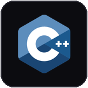
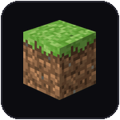
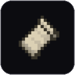

# Raejy
I build things around Minecraft, Discord and web development. Most of my work focuses on creating useful tools to speed up tedious tasks, systems and projects.

### Projects

**[Authority](https://authority.mom)**  
A Discord bot focused on server management, moderation and utility features.

**[Rae's Lab](https://discord.gg/9RaMVadcRA)**  
A community for sharing projects, getting help and connecting with other developers.

## Tech Stack
**Languages & Web**

  
  
  
  
  
  
  
  
  
  

**Minecraft Development**

  
  
  
  
  

**Databases & Backend**

  
  
  

**Tools & Development**

  
  
  
  
  
  
  
  
  

### Links
- **Website:** [authority.mom](https://authority.mom)
- **Discord:** [Rae's Lab](https://discord.gg/9RaMVadcRA)
- **Authority Bot:** [Invite to your server](https://discord.com/oauth2/authorize?client_id=1212327880902844427&scope=bot%20applications.commands)
- **Modrinth:** [Raejy](https://modrinth.com/user/Raejy)
